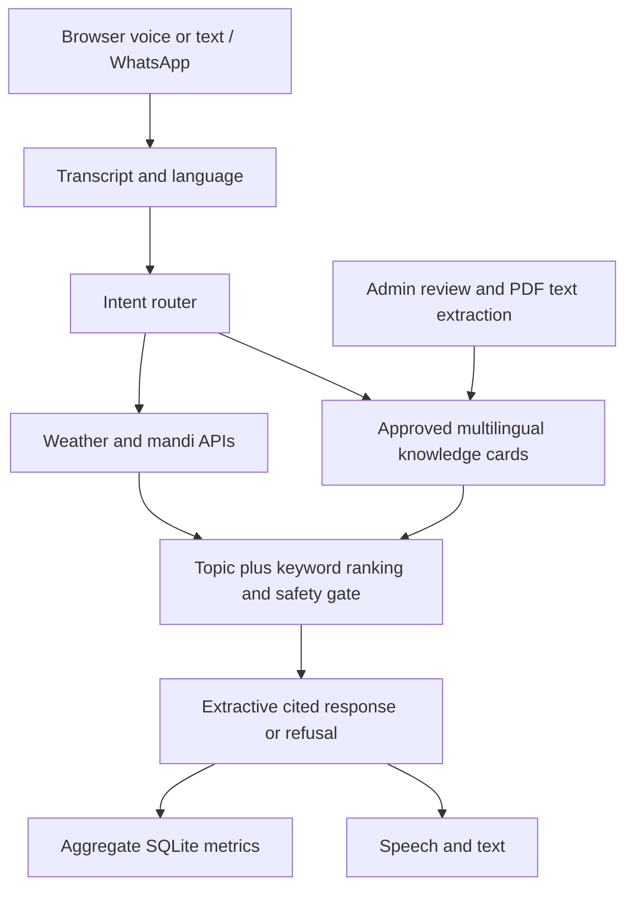

# KrishiVaani AI — Voice-first multilingual agricultural assistant

A compact college IA application implementing a source-grounded, multilingual extractive retrieval pipeline, a voice-enabled mobile-friendly web interface, live data adapters, and an optional WhatsApp Cloud API channel. No local model weights, Node.js, vector database or Docker required to run locally.

## Windows / S: drive quick start

Extract this archive **into the existing project root** `S:\Projects\KrishiVaani-AI` (overwrite named files, keep `.git`). Open PowerShell there. If your existing venv is valid, reuse it. Otherwise create one on S:.

```powershell
cd S:\Projects\KrishiVaani-AI
if (!(Test-Path .venv\Scripts\python.exe)) { py -3.11 -m venv .venv }
New-Item -ItemType Directory -Force S:\Temp | Out-Null
$env:TEMP='S:\Temp'; $env:TMP='S:\Temp'
.\.venv\Scripts\python.exe -m pip install --no-cache-dir -r backend\requirements.txt
if (!(Test-Path .env)) { Copy-Item .env.example .env }
notepad .env
```

Set `ADMIN_KEY` to a strong private value. Set optional keys as described below. Save the file. No credentials are required for the knowledge, refusal or basic weather endpoints.

```powershell
cd backend
..\.venv\Scripts\python.exe -m pytest -q
$env:PYTHONIOENCODING='utf-8'
..\.venv\Scripts\python.exe evaluate.py
..\.venv\Scripts\python.exe -m uvicorn app.main:app --host 127.0.0.1 --port 8000
```

Open http://127.0.0.1:8000 in Chrome/Edge. Swagger API: http://127.0.0.1:8000/docs. Choose language, type or speak, inspect transcript, click Ask, then Listen. Browser support and Internet access vary. Speech may be processed by external providers; use only consented, non-sensitive samples. If browser voice output is missing, the application tries gTTS; it also requires network access. Browser microphone and audio upload are optional; type if unavailable.

## Suggested demo

- Marathi: `पीएम किसान योजनेत किती पैसे मिळतात?`
- Hindi: `कपास में गुलाबी सुंडी की निगरानी कैसे करें?`
- Marathi: `सोयाबीन शेतात पाणी साचले तर काय करावे?`
- Weather: `पुण्यात आज हवामान कसे आहे?` or select Weather, enter `Pune` in location.
- Mandi: select Mandi, enter `Pune` and `Onion`; API key needed. Exact market and commodity names may differ. No sample price is substituted if unavailable.
- Safe refusal: `कापसाची पाने पिवळी का पडतात?` or `cotton pesticide dosage`.

## Architecture



The retrieval confidence is a heuristic matching score, **not a calibrated probability**. Prewritten localized answers are returned directly from approved evidence cards, reducing generation hallucinations; there is no vector search, LLM or dynamic translation. The seed cards contain original paraphrases of linked public sources, not independently expert-approved recommendations. The seed approval flag indicates inclusion in the classroom demo; review with an agricultural expert before use with farmers. Chemical dosages and unsupported diagnoses are refused. This does not guarantee absence of incorrect intent or matches. General crop principles are not state-specific treatment schedules.

## Data and admin

Five seed knowledge cards in `backend/data/knowledge.json` form the source register (publisher, link, date, region, crop, version, language, usage note and approval). Source dates are marked unknown when unavailable. Admin UI supports PDF text extraction (5 MB/20 pages), manually curated multilingual evidence cards, pending/approve/revoke, version increments, inspecting metadata and aggregate metrics. There is no automatic OCR, translation, or expert review. Do not upload copyrighted files without permission. SQLite stores approved revisions' current state, consent preference and aggregate logs; it does not preserve full version history. Back up `storage/` privately. No raw audio or question text is stored in the app database.

## Live mandi data

Register at https://www.data.gov.in/ and obtain an API key for the public API. Set `DATA_GOV_API_KEY` in `.env`. Source: https://data.gov.in/resource/current-daily-price-various-commodities-various-markets-mandi . The adapter selects the latest valid record among up to 100 returned matching records, displays its reported date, variety and modal price per quintal, and refuses if the service fails. It is not guaranteed to be the newest record across all pages. Weather uses Open-Meteo noncommercial service (https://open-meteo.com/en/docs); forecast is not an official IMD agromet advisory. Check provider terms before public deployment.

## Optional hosted speech and WhatsApp

1. Obtain `GROQ_API_KEY` from https://console.groq.com/keys. The app sends audio to Groq Whisper transcription; access, quotas and terms can change. Browser text/voice does not require this key.
2. Set up a Meta developer app with WhatsApp Cloud API: https://developers.facebook.com/docs/whatsapp/cloud-api/ . Use its test phone number and add your verified test recipient. Obtain the token, phone number ID, app secret and supported Graph API version (e.g. use exactly the version shown in Meta's setup page, including `v`). Set the five `WA_` variables in `.env`; choose a private random verify token.
3. Deploy the service to a public HTTPS host (Dockerfile included) or expose your local server using an HTTPS tunnel for classroom testing. Set webhook callback `https://YOUR_HOST/webhook`, enter `WA_VERIFY_TOKEN`, and subscribe to `messages`. Configure the app's privacy notice and test accounts before connecting. Do not publicly expose an unprotected service to real users. The webhook checks Meta HMAC signatures.
4. From a test recipient, send `START MR`, `START HI` or `START EN` to consent. Send text or a voice note. Examples: `weather Pune`, `mandi Pune; Onion`, or a supported crop/scheme question. The service sends a text response and attempts an MP3 audio message via Meta's media endpoint. `STOP` withdraws consent. Supported city/commodity aliases can be extracted from spoken requests; ambiguous or unknown names require clarification or explicit text format.

Webhook processing uses FastAPI background tasks, not a durable queue; duplicates are suppressed locally, but failed deliveries are not automatically retried. The audio is sent as an audio attachment, not guaranteed to render as a native push-to-talk note. Meta, Groq and gTTS may incur cost, limits or downtime. External integration is implemented but not verified using live credentials. A public deployment needs rate limits, authentication, privacy review and persistent storage volume for `storage/`.

## Evaluation

```powershell
cd S:\Projects\KrishiVaani-AI\backend
..\.venv\Scripts\python.exe -m pytest -q
$env:PYTHONIOENCODING='utf-8'
..\.venv\Scripts\python.exe evaluate.py | Set-Content -Encoding utf8 evaluation_results.json
```

`evaluate.py` measures Recall@5, correct supported-answer rate, refusal accuracy, exact evidence-copy rate, and backend latency on 21 handcrafted seed cases. This is a smoke benchmark, not independent retrieval accuracy, expert faithfulness or voice-to-voice latency. `evaluation_results.json` contains the measured run supplied with this package. To measure real ASR WER, copy the empty `data/voice_samples_template.csv` into a private CSV (not in Git), add consented manually transcribed reference and actual transcript columns, and run `python voice_evaluation.py path-to-private.csv`. Translation review, native-speaker scoring, comparison against another model, real end-to-end latency and pilot usefulness remain unmeasured; do not report fabricated values.

## Deployment

For IA demonstration use local server; for an HTTPS deployment use a Python host or supplied Dockerfile (optional). Environment variables are set in hosting dashboard rather than uploading `.env`. Start command: `cd backend && python -m uvicorn app.main:app --host 0.0.0.0 --port ${PORT:-8000}` on Linux. Attach persistent storage at `/app/storage` if using Docker. Use one worker for classroom testing.

## Git checkpoints

Run from project root; review status before each push. Keep .env, storage, recordings and private source data out of Git. Do not commit someone else's problem statement without authorization.

```powershell
git add .gitignore .env.example backend/requirements.txt backend/app/core.py backend/data/knowledge.json
git commit -m "feat: add multilingual knowledge retrieval and live data adapters"
git push origin main
git add backend/app/main.py backend/app/static
git commit -m "feat: add voice interface, admin API and WhatsApp integration"
git push origin main
git add backend/tests backend/evaluate.py backend/voice_evaluation.py backend/data/voice_samples_template.csv backend/evaluation_results.json README.md Dockerfile .dockerignore
git commit -m "test: add evaluation and deployment documentation"
git push origin main
```

If a checkpoint has no changes, skip its commit. These are logical grouping checkpoints for code delivered together, not a claim that modules were developed independently over time.
